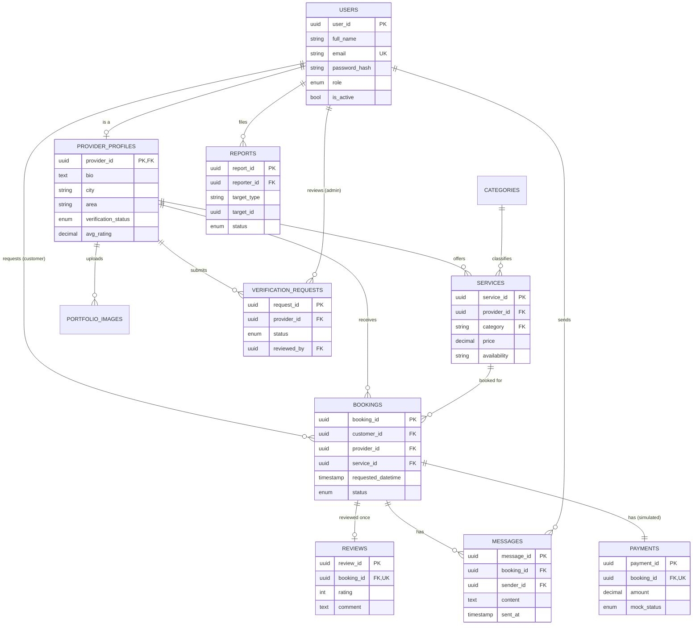
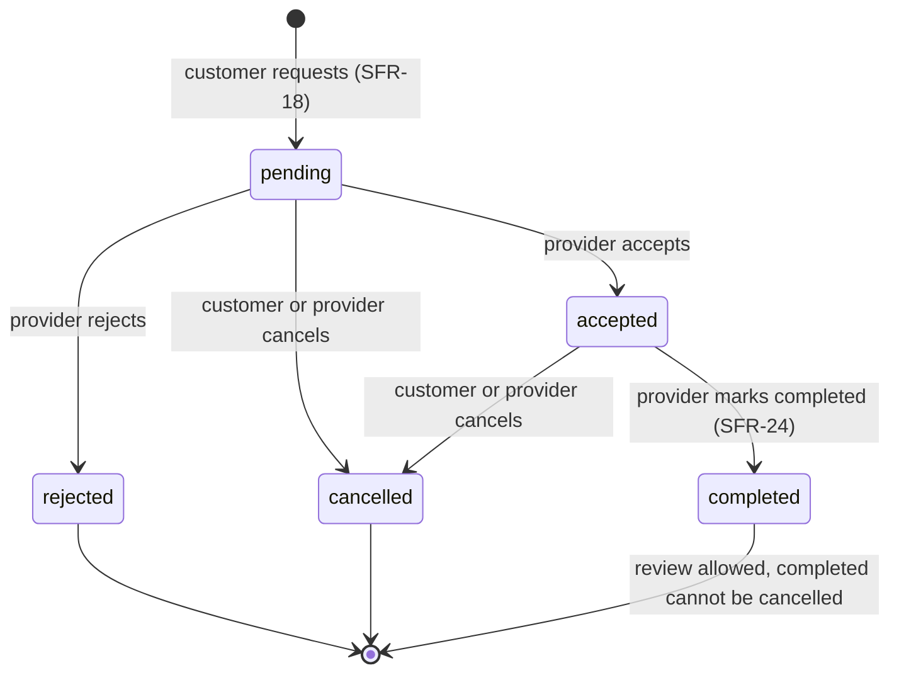
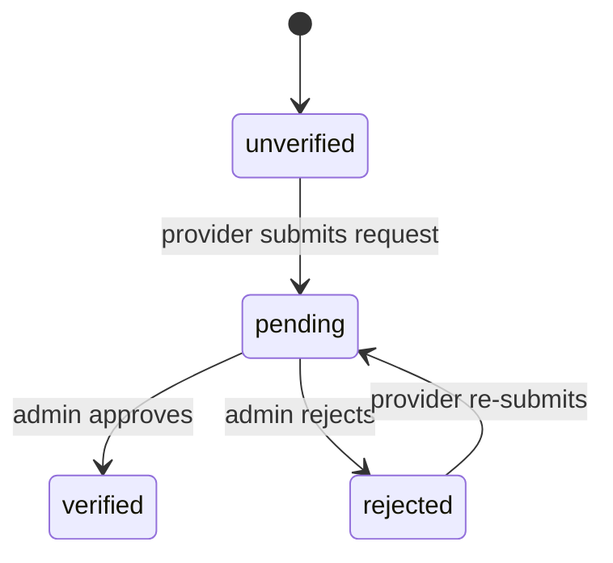
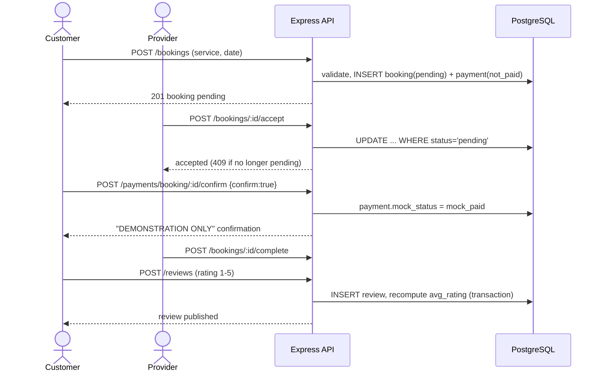
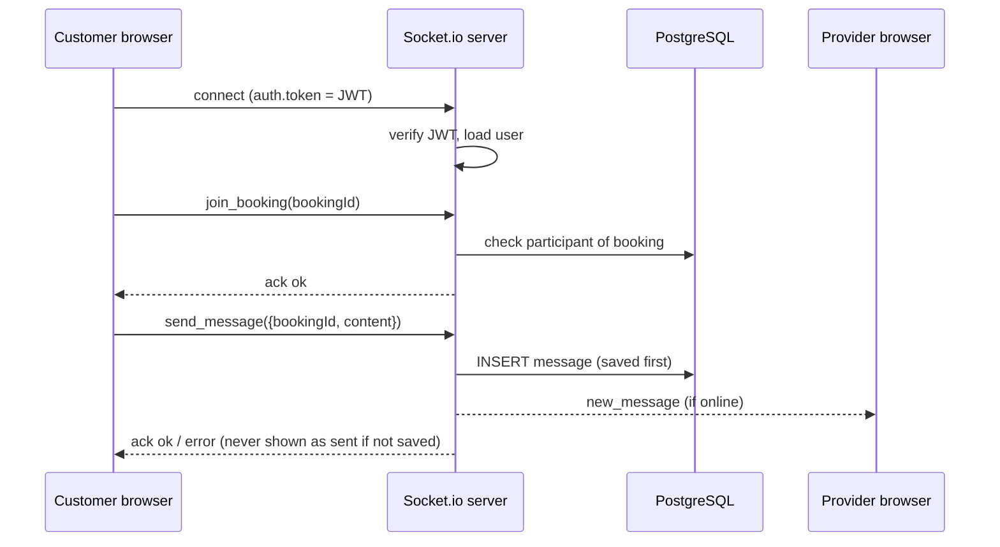
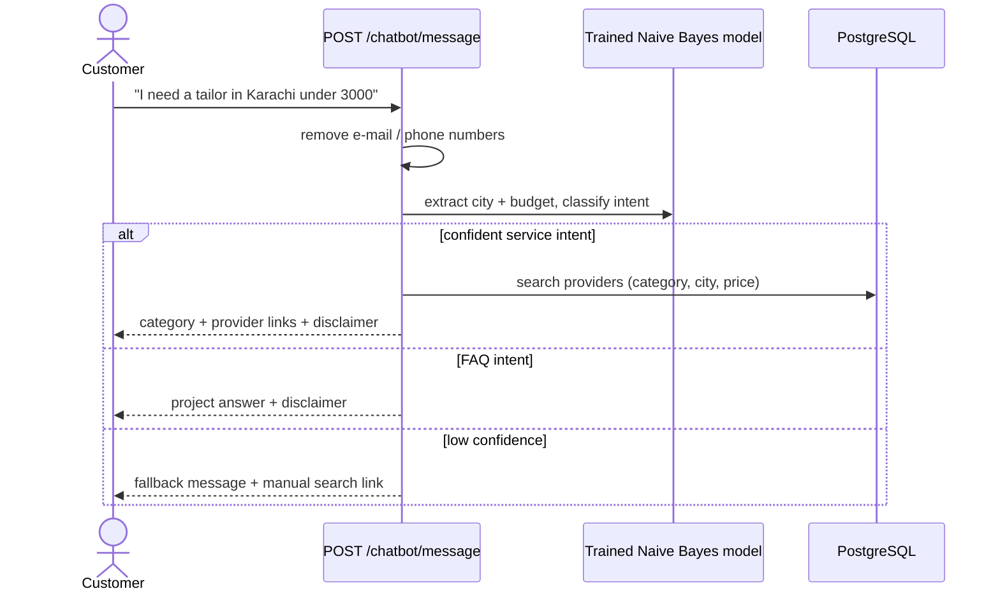
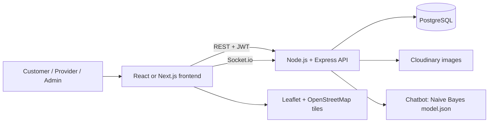

# Diagrams for the report (rubric criteria 4 and 5)

Paste each block into https://mermaid.live , export as PNG/PDF, and include it in your LaTeX report with `\includegraphics`.

## 1. Entity-Relationship Diagram (Database Design)

## 2. Booking state machine (Behavioural model)

## 3. Verification state machine

## 4. Sequence diagram: booking, payment and review

## 5. Sequence diagram: real-time chat

## 6. Sequence diagram: chatbot

## 7. System architecture (Component diagram)

